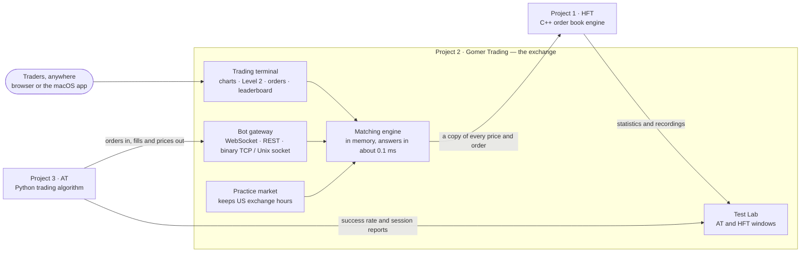

# Model Project

**Three projects that together make a small electronic trading world: an
exchange engine, an exchange people trade on, and an algorithm that trades on
it.** Each one is a complete project in its own repository. This repository
ties them together and explains how they fit.

| | Project | Language | What it is |
|---|---|---|---|
| 1 | [**HFT — Low-Latency Order Book**](https://github.com/GOMER20/Project-1-Low-Latency-Order-Book) | C++20 | The matching engine: the data structure at the heart of an exchange, matching orders by price, then time, in about 20 nanoseconds |
| 2 | [**Gomer Trading**](https://github.com/GOMER20/Project-2-Gomer-Trading) | TypeScript (Node.js, Next.js, Electron) | The exchange people use: a Sterling-Pro-style trading terminal and competition platform, as a macOS app and a web server |
| 3 | [**AT — Algorithmic Trading**](https://github.com/GOMER20/Project-3-AT-Algorithmic-Trading) | Python | The trader that is not a person: a researched strategy, a backtester that tries hard to prove it wrong, and a bot that trades live on Gomer Trading |

The folders above (`Project-1-HFT-Order-Book`, `Project-2-Gomer-Trading`,
`Project-3-AT-Algorithmic-Trading`) are links to those repositories at the
exact versions that work together. To get all three at once:

```bash
git clone --recurse-submodules https://github.com/GOMER20/Model-Project.git
```

## Overview

Real markets have three kinds of moving part. There is the **matching
engine**, the code inside an exchange that holds every buy and sell order and
decides who trades with whom. There is the **venue** that people actually
use, with its screens, accounts, rules, risk checks and results. And there are
**trading programs**, which connect to the venue through the same doors as
people, only faster, and trade by rules instead of by eye.

The Model Project builds one of each, from scratch, and connects them:

- **Gomer Trading** (Project 2) is the venue. Traders get a $100,000 paper
  account in a competition and trade on a professional terminal: charts,
  Level 2 depth, bracket orders, margin calls, a live leaderboard and a
  declared winner. It runs as a macOS app on one Mac and can share itself with
  traders anywhere at a permanent internet address. Its prices come from a
  realistic built-in practice market that keeps US exchange hours, or from a
  real-time data feed when a key is added.
- **AT** (Project 3) is a trading program. It was researched and tested
  against Gomer Trading's own market, then admitted to the exchange as a bot
  with its own API key. It signs in through Gomer Trading's bot gateway at the
  opening bell, trades its strategy, and after every session writes a report
  that explains each losing trade.
- **HFT** (Project 1) is the engine. It runs beside Gomer Trading in test
  mode: the exchange sends it a copy of every price and every order, HFT
  matches them in a real order book of its own and measures itself, and each
  session is recorded so it can be replayed exactly.

Inside Gomer Trading, the **Test Lab** on the opening screen shows AT and HFT
side by side with the sign-in box, and opens a window for each: AT's success
rate, trades and reports; HFT's speed, session by session.

## How they connect



| Link | How it works |
|---|---|
| AT → Gomer Trading | AT is an ordinary trading program to the exchange: an API key pinned to a sandbox competition, orders through the bot gateway, execution reports and market data back. Its research history was generated from the same price model the practice market uses. |
| Gomer Trading → HFT | Gomer Trading starts the `hft` program, sends it every quote and order over a local socket, and starts a fresh HFT session at each US market open. In test mode Gomer Trading's own engine still decides every fill, so HFT can be measured without being able to affect an account. |
| HFT and AT → Gomer Trading | The Test Lab reads AT's results from the exchange's own records of its fills, plus the reports AT writes about itself, and reads HFT's statistics from the files each of its sessions leaves behind. |

## What we have been building

The three projects were built in October 2026 by
[GOMER20](https://github.com/GOMER20) together with Claude (Anthropic's AI
model, working in Claude Code): GOMER20 set the goals, chose between options
and asked for changes; Claude designed, wrote, tested and documented the code,
and reported results plainly, including the ones that did not go as hoped.

| Date | What was built |
|---|---|
| 9 Oct | **HFT:** the order book, lock-free rings, an engine thread, market / IOC / FOK orders, several engine threads sharing symbols by measured load, a market data feed. **Gomer Trading:** the terminal, competitions, live leaderboard, the macOS app, sharing over the internet at a permanent address. |
| 10 Oct | **HFT:** record and replay; the `hft` program other programs connect to. **Gomer Trading:** bracket orders, account management, backups, margin calls, commissions, Level 2 depth, partial fills; the bot gateway for trading programs; an in-memory engine answering in well under a millisecond; a practice market that keeps real US exchange hours. **AT:** the first research, backtester and bot. |
| 11 Oct | HFT embedded in Gomer Trading in test mode, with recordings kept within a fixed disk budget. |
| 12 Oct | AT's loss review: what the losing trades had in common, new filters, a second walk-forward. |
| 14–15 Oct | AT starts itself at the opening bell; trades in its own long-running sandbox and on the Demo Trading Challenge leaderboard. |
| 17 Oct | The Test Lab with AT and HFT windows; all three projects published, and this overview. |

## Results so far

Measured, not promised:

- **HFT:** about 20 ns to insert, cancel or match an order in the book on a
  laptop. Inside Gomer Trading, during live US sessions, it has kept up with
  every price update (typically 6–8 µs each, nothing refused or lost). No
  orders reached it in those sessions, so its order timings come from tests.
- **Gomer Trading:** from a trading program on the same Mac, an order is
  answered in about 0.1–0.2 ms (median), and 99.7% of orders in under 1 ms;
  12,000–14,000 orders a second; 600 simultaneous traders in a load test.
  Every order is journalled before it is answered, and a crash mid-burst was
  recovered with every acknowledged fill intact.
- **AT:** on 60 practice-market sessions its settings had never seen, it won
  **91.4% of 5,947 trades** (random entries with the same exits: 60.5%). Live,
  its two short first-round trials won 63.6% of 22 trades; the loss review
  that followed produced the second-round settings. Live sessions with those
  settings are reported in AT's own window. No win rate is guaranteed: these
  are results on a simulated market.

Everything trades on paper. No real money is involved anywhere.

## Running them

Each project's README has the details:

- HFT: `cmake` build, tests, benchmarks, and the `hft serve | simulate | verify` program.
- Gomer Trading: `npm run dev` for the web stack, `npm run app:build` for the macOS app (which includes HFT).
- AT: a Python virtual environment, `scripts/run_research.py` for the research, `scripts/run_at.py` to trade on a running Gomer Trading.
